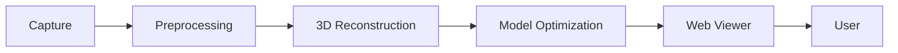

# Namma Space – Digital Twin

> A browser-based 3D digital copy of a real indoor space, built from captured visual data.

**Namma Space – Techfest, IIT Bombay · Round 1**

| | |
|---|---|
| **Team** | [TEAM NAME] |
| **Web Viewer** | [WEB VIEWER URL] |
| **Demo Video** | [DEMO VIDEO URL] |
| **Repository** | [GITHUB URL] |

> **Status:** Round 1 work in progress. Sections marked with `[PLACEHOLDER]` will be filled in as the implementation is finalized.

---

## Table of Contents

1. [Project Overview](#project-overview)
2. [Problem Statement](#problem-statement)
3. [Objective](#objective)
4. [Round 1 Scope](#round-1-scope)
5. [Key Features](#key-features)
6. [System Architecture](#system-architecture)
7. [3D Reconstruction Pipeline](#3d-reconstruction-pipeline)
8. [Technology Stack](#technology-stack)
9. [Repository Structure](#repository-structure)
10. [How It Works](#how-it-works)
11. [Local Setup](#local-setup)
12. [Running the Web Viewer](#running-the-web-viewer)
13. [Adding / Replacing the 3D Model](#adding--replacing-the-3d-model)
14. [Deployment](#deployment)
15. [Demo](#demo)
16. [Screenshots](#screenshots)
17. [Future Scope – Round 2](#future-scope--round-2)
18. [Team](#team)
19. [Competition](#competition)
20. [License](#license)

---

## Project Overview

**Namma Space – Digital Twin** creates a digital twin of an indoor environment from captured visual data and presents the reconstructed environment through an interactive, web-based 3D viewer.

The pipeline takes a physical indoor space, captures it visually, processes the captured data, reconstructs a 3D representation, optimizes that representation for web delivery, and loads it into a browser-based viewer where a user can explore it.

## Problem Statement

Physical indoor spaces such as campus buildings, labs, and halls are typically documented with floor plans or photographs. These formats do not let a person explore the layout spatially before, or without, being on site.

A 3D digital copy that opens directly in a browser makes an indoor space viewable without installing specialized software.

## Objective

Create a 3D digital copy of an indoor physical space and make it accessible and interactive through a web browser, so that a user can open a website and freely explore the reconstructed environment.

## Round 1 Scope

Round 1 covers the path from physical space to interactive 3D viewing:

```
Physical Indoor Space
→ Visual Capture
→ Frame Extraction / Preprocessing
→ 3D Reconstruction
→ Web Optimization
→ Interactive 3D Web Viewer
```

Anything outside this path (search, navigation, semantic labelling) is out of scope for Round 1 and is listed under [Future Scope – Round 2](#future-scope--round-2).

## Key Features

Round 1 functionality:

- Indoor environment capture
- Visual data preprocessing
- 3D reconstruction
- 3D model optimization for web
- Browser-based 3D visualization
- Interactive camera movement
- Free exploration of the reconstructed environment
- Responsive web interface

## System Architecture



| Stage | Role |
|---|---|
| **Capture** | Record images or video of the indoor space |
| **Preprocessing** | Extract and prepare frames for reconstruction |
| **3D Reconstruction** | Generate a 3D representation from the prepared data |
| **Model Optimization** | Reduce the model to a size and format suitable for the web |
| **Web Viewer** | Load and render the model in the browser |
| **User** | Explores the environment interactively |

## 3D Reconstruction Pipeline

| Step | Description | Tool / Method |
|---|---|---|
| 1. Capture | Record the indoor space with overlapping views | `[CAPTURE DEVICE / METHOD]` |
| 2. Frame extraction | Select useful frames from the captured footage | `[FRAME EXTRACTION TOOL]` |
| 3. Preprocessing | Clean, filter, and organize the input images | `[PREPROCESSING STEPS]` |
| 4. Reconstruction | Generate a 3D mesh or point-based representation | `[RECONSTRUCTION TOOL / FRAMEWORK]` |
| 5. Optimization | Simplify geometry and compress textures for web delivery | `[OPTIMIZATION TOOL]` |
| 6. Export | Produce the final web-ready asset | `[MODEL FORMAT, e.g. GLB]` |

> The specific reconstruction framework has not been finalized. This table will be updated once the tools actually used are confirmed.

## Technology Stack

Entries in brackets are placeholders until the final stack is confirmed.

| Layer | Technology |
|---|---|
| Frontend framework | React `[TO BE CONFIRMED]` |
| Build tool | Vite `[TO BE CONFIRMED]` |
| 3D rendering | Three.js on WebGL `[TO BE CONFIRMED]` |
| Language | JavaScript `[TO BE CONFIRMED]` |
| Processing scripts | Python `[TO BE CONFIRMED]` |
| 3D reconstruction | `[RECONSTRUCTION / PHOTOGRAMMETRY TOOL]` |
| Model optimization | `[OPTIMIZATION TOOL]` |
| Version control | Git and GitHub |

## Repository Structure

```
namma-space-digital-twin/
├── README.md
├── LICENSE
├── .gitignore
├── frontend/
├── reconstruction/
├── assets/
├── docs/
└── demo/
```

| Path | Purpose |
|---|---|
| `README.md` | Project documentation |
| `LICENSE` | License terms for the repository |
| `.gitignore` | Files and folders excluded from version control (e.g. `node_modules`, large raw captures) |
| `frontend/` | Web viewer source code, including the `public/models/` folder for the final 3D asset |
| `reconstruction/` | Scripts, configuration, and notes for frame extraction, preprocessing, reconstruction, and optimization |
| `assets/` | Static project assets such as screenshots and diagrams |
| `docs/` | Supporting documentation, including the technical abstract |
| `demo/` | Demo-related material, such as links or notes for the demo video |

## How It Works

1. **Capture** the indoor environment.
2. **Extract** useful visual information from the captured data.
3. **Process** the captured data to prepare it for reconstruction.
4. **Generate** a 3D representation of the environment.
5. **Optimize** the resulting model for web delivery.
6. **Load** the model into the browser.
7. **Explore**: users move through the environment interactively.

### Web Viewer

The viewer is intended to provide:

- 3D rendering
- Camera controls
- Smooth movement
- Zoom and rotation where applicable
- Loading feedback
- Responsive presentation

The exact set of controls depends on the final implementation and will be documented here once finalized.

## Local Setup

**Prerequisites:** [Node.js](https://nodejs.org/) (LTS recommended) and npm.

```bash
# Clone the repository
git clone [GITHUB URL]
cd namma-space-digital-twin

# Install and start the frontend
cd frontend
npm install
npm run dev
```

> These are generic commands for a Vite/React frontend. Exact commands may change depending on the final implementation.

## Running the Web Viewer

1. Start the development server as shown above.
2. Open the local URL printed in the terminal (Vite typically uses `http://localhost:5173`).
3. Wait for the model to finish loading, then use the on-screen camera controls to explore.

To create a production build:

```bash
npm run build
npm run preview
```

## Adding / Replacing the 3D Model

The final optimized 3D asset goes in:

```
frontend/public/models/
```

1. Export the optimized model from the reconstruction pipeline.
2. Place the file in `frontend/public/models/` (e.g. `YOUR_MODEL_FILE`).
3. Update the model path in the viewer's source code to point to `/models/YOUR_MODEL_FILE`.
4. Restart the dev server if it is running, and reload the page.

> Keep the web asset as small as practical. Large raw captures and intermediate reconstruction outputs should stay out of version control (see `.gitignore`).

## Deployment

The frontend is a static site once built and can be hosted on services such as:

- Vercel
- Netlify
- GitHub Pages

General steps:

```bash
cd frontend
npm run build
```

Then deploy the generated build output (typically `dist/`) with the chosen service.

> Deployment has not been completed yet. The live URL will be added here as **[WEB VIEWER URL]** once available.

## Demo

| Item | Link |
|---|---|
| Web Viewer | [WEB VIEWER URL] |
| Demo Video (3–5 min) | [DEMO VIDEO URL] |

## Screenshots

*Placeholders. Images will be added as the viewer is completed.*

| Landing Page | 3D Viewer |
|---|---|
|  |  |

| Reconstructed Indoor Environment | Full-Screen Exploration |
|---|---|
|  |  |

## Future Scope – Round 2

> **The items below are planned directions, not part of the current Round 1 implementation.**

- Points of Interest (POIs)
- POI search
- Room identification
- Entrance identification
- Obstacle-aware navigation
- Pathfinding
- Interactive navigation between locations

## Team

**Team name:** [TEAM NAME]

**Members:** [TEAM MEMBERS]

## Competition

**Namma Space – Techfest, IIT Bombay**

Round 1 deliverables:

| Deliverable | Status / Link |
|---|---|
| Technical Abstract | `[LINK / PATH IN docs/]` |
| Web Viewer Link | [WEB VIEWER URL] |
| GitHub / Code Repository | [GITHUB URL] |
| 3–5 minute Demo Video | [DEMO VIDEO URL] |

## License

This project is licensed under the terms of the license in the [LICENSE](LICENSE) file. `[CONFIRM LICENSE TYPE]`
